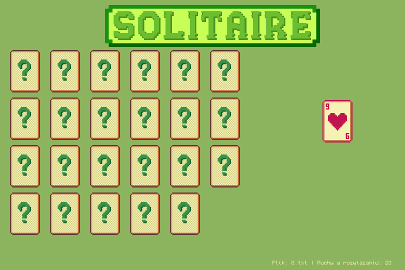
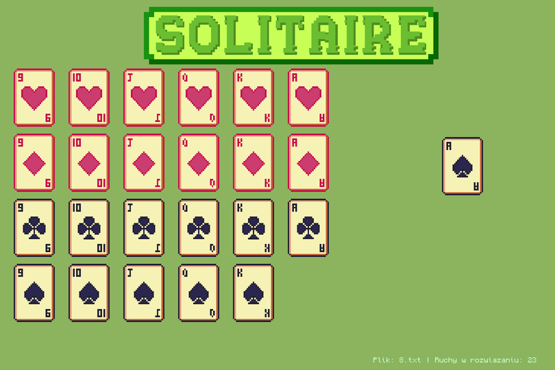

# Solitaire Simulator

**English** | [Polski](README.pl.md)


A batch simulator for a single-player card game, *pasjans* ("solitaire" in Polish). It reads any number of deck files,
plays each deal automatically, reports which deals can be solved, and replays the winning ones in a
pixel-art Pygame visualization.

<p align="center">
  
</p>

## Features

- **Batch processing:** every `*.txt` deck in `in/` is checked in one run.
- **Input validation:** wrong card count, duplicate cards and cards that don't exist are reported instead of crashing.
- **HTML report:** a summary table of all deals in `out/raport.html`.
- **Per-deal logs:** `out/logs/<deck>_log.txt` with status and move count.
- **Automatic backups:** each run copies `in/` and `out/` into a timestamped folder in `backup/`.
- **Visual replay:** winning games are saved to `out/replay.pkl` and replayed move by move with original pixel-art cards.

## The game

The game uses a 24-card deck with four suits and six ranks per suit: **9, 10, J, Q, K, A**. The suit names are Polish:

| In files | Suit |
|---|---|
| `Kier`  | ♥ Hearts   |
| `Karo`  | ♦ Diamonds |
| `Trefl` | ♣ Clubs    |
| `Pik`   | ♠ Spades   |

**Goal:** arrange the table so that each row holds one suit (♥, ♦, ♣, ♠ from top to bottom) and the ranks run 9 → A
from left to right:

<p align="center">
  
</p>

**Rules:**

1. **Deal.** The first 23 cards are laid face down into a 4 × 6 grid, row by row. The bottom-right slot stays empty.
   The 24th card goes to your hand.
2. **Move.** Put the card in your hand into its target slot (row = suit, column = rank) and pick up the card that was there.
3. **End.** The game ends when the **ace of spades** (`Pik A`) comes to your hand, because its slot is the empty one.
   You **win** if every other card is in its place at that point.

There are no decisions in this game: the deal alone decides the outcome, so the simulator works out whether each deal can be solved.
A deal is solved in at most 23 moves, since each move fixes one card in place for good.

> **Fun fact:** a deal is a permutation of the cards. The game follows exactly one cycle of it: the one that
> ends at the empty slot. So a deal is solvable **if and only if every misplaced card lies on that cycle.**

## Getting started

### Requirements

- Python **3.9+**
- [pygame-ce](https://pyga.me/), a maintained drop-in fork of Pygame that also has wheels for the newest Python versions.
  The original `pygame` works too wherever it installs.
- A screen of about **1920 × 1080**. The replay layout uses fixed pixel positions.

```bash
git clone https://github.com/creepymarryad/solitaire-simulator.git
cd solitaire-simulator
pip install -r requirements.txt
```

### Run

**Windows:** double-click `run.bat`. A small menu runs the simulation, opens the report and asks whether to
start the visualization.

**Linux / macOS:**

```bash
./run.sh
```

**Or run the steps yourself:**

```bash
python main.py --batch    # simulate all decks in in/, write report, logs and backup
python main.py --replay   # replay all winning games (Esc = next game)
```

## Input format

Each file in `in/` contains **24 lines**, one card per line, in dealing order, written as `Suit Rank`:

```text
Kier 9
Pik A
Trefl J
Karo 10
...
```

The repository includes sample decks that cover every outcome:

| File | Result | Why |
|---|---|---|
| `1.txt` | ❌ Data error | only 20 cards |
| `2.txt` | ❌ Data error | duplicate card `Trefl Q` |
| `3.txt` | ❌ Data error | card that doesn't exist: `Pik 15` |
| `4.txt` | ➖ Loss | ace of spades reached after 16 moves, but the layout is incomplete |
| `5.txt` | ➖ Loss | ace of spades reached after 15 moves, but the layout is incomplete |
| `6.txt` | ✅ Win | already sorted (0 moves) |
| `7.txt` | ✅ Win | 23 moves |
| `8.txt` | ✅ Win | 23 moves (the GIF above) |

## Project structure

```text
├── main.py          # entry point: batch mode, HTML report, logs, backup, replay launcher
├── logic.py         # pure game rules: deck loading/validation, dealing, moves, win check
├── game_class.py    # Pygame renderer for the step-by-step replay
├── card_class.py    # Card sprite
├── run.bat          # Windows menu
├── run.sh           # Linux/macOS launcher
├── assets/          # pixel-art cards, title, Monocraft font
├── in/              # input decks
├── out/             # generated: raport.html, logs/, replay.pkl
└── backup/          # generated: timestamped copies of in/ and out/
```

`logic.py` doesn't import Pygame, so the game rules can be tested or reused without any graphics.

## About

This project was built for the **Scripting Languages** (*Języki skryptowe*) course at university, in the winter
semester of 2025/26. The program's messages and the generated report are in Polish.

## License

The code and the card/title artwork are released under the [MIT License](LICENSE).
The [Monocraft](https://github.com/IdreesInc/Monocraft) font in `assets/` is © Idrees Hassan and licensed under the
[SIL Open Font License 1.1](https://github.com/IdreesInc/Monocraft/blob/main/LICENSE).
