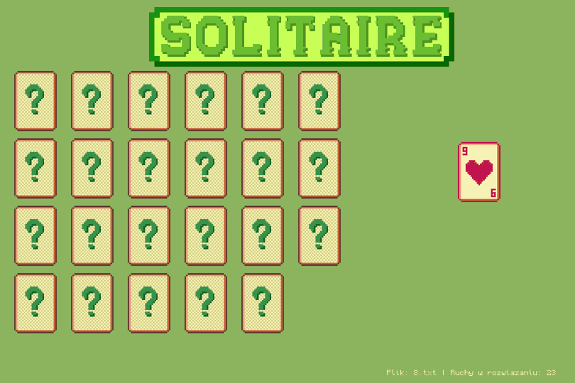
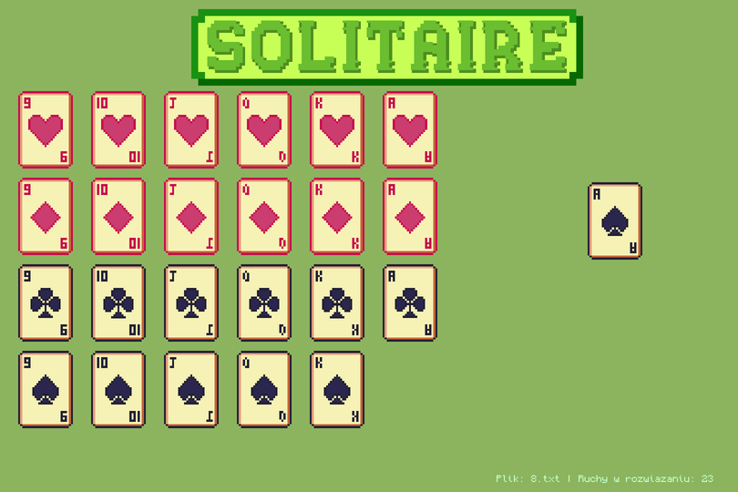

# Symulator Pasjansa

[English](README.md) | **Polski**


Wsadowy symulator jednoosobowej gry karcianej typu pasjans. Program wczytuje dowolną liczbę plików z układami kart,
automatycznie rozgrywa każdą partię, raportuje, które układy da się rozwiązać, a wygrane partie odtwarza krok po kroku
w wizualizacji pixel-art (Pygame).

<p align="center">
  
</p>

## Funkcje

- **Przetwarzanie wsadowe:** w jednym uruchomieniu sprawdzane są wszystkie pliki `*.txt` z folderu `in/`.
- **Walidacja danych:** zła liczba kart, duplikaty i nieistniejące karty są zgłaszane, program się nie wysypuje.
- **Raport HTML:** zbiorcza tabela wyników w `out/raport.html`.
- **Logi:** osobny plik `out/logs/<plik>_log.txt` dla każdego układu.
- **Automatyczny backup:** każde uruchomienie kopiuje `in/` i `out/` do folderu z datą i godziną w `backup/`.
- **Wizualizacja:** wygrane partie są zapisywane w `out/replay.pkl` i odtwarzane ruch po ruchu z autorskimi kartami w stylu pixel-art.

## Zasady gry

Talia ma 24 karty: cztery kolory (**Kier ♥, Karo ♦, Trefl ♣, Pik ♠**) i po sześć figur w każdym (**9, 10, J, Q, K, A**).

**Cel:** ułożyć karty tak, aby każdy wiersz zawierał jeden kolor (od góry: ♥, ♦, ♣, ♠), a figury szły od lewej
do prawej w kolejności 9 → A:

<p align="center">
  
</p>

**Przebieg:**

1. **Rozdanie.** Pierwsze 23 karty trafiają zakryte na stół, wierszami, do siatki 4 × 6. Prawe dolne pole zostaje puste.
   24. karta trafia do ręki.
2. **Ruch.** Kartę z ręki kładziemy na jej docelowe pole (wiersz = kolor, kolumna = figura) i podnosimy kartę, która tam leżała.
3. **Koniec.** Gra kończy się, gdy do ręki trafi **as pik** (`Pik A`), bo jego pole jest tym pustym.
   Partia jest **wygrana**, jeśli wszystkie pozostałe karty leżą wtedy na swoich miejscach.

W tej grze nie ma żadnych decyzji: wynik zależy wyłącznie od rozdania, więc symulator rozstrzyga, czy dany układ jest
rozwiązywalny. Każdy ruch na stałe ustawia jedną kartę, więc partia kończy się po najwyżej 23 ruchach.

> **Ciekawostka:** rozdanie to permutacja kart, a gra przechodzi dokładnie jeden jej cykl: ten, który kończy się
> na pustym polu. Układ jest więc rozwiązywalny **wtedy i tylko wtedy, gdy wszystkie źle położone karty leżą na tym cyklu.**

## Uruchomienie

### Wymagania

- Python **3.9+**
- [pygame-ce](https://pyga.me/), utrzymywany fork Pygame z gotowymi paczkami dla najnowszych wersji Pythona.
  Oryginalny `pygame` też działa tam, gdzie da się go zainstalować.
- Ekran ok. **1920 × 1080**, bo wizualizacja używa stałych pozycji w pikselach.

```bash
git clone https://github.com/creepymarryad/solitaire-simulator.git
cd solitaire-simulator
pip install -r requirements.txt
```

### Start

**Windows:** dwuklik na `run.bat`. Menu uruchamia symulację, otwiera raport i pyta o uruchomienie wizualizacji.

**Linux / macOS:**

```bash
./run.sh
```

**Albo ręcznie:**

```bash
python main.py --batch    # symulacja wszystkich plików z in/, raport, logi, backup
python main.py --replay   # odtworzenie wygranych partii (Esc = następna partia)
```

## Format danych wejściowych

Każdy plik w `in/` zawiera **24 linie**, po jednej karcie na linię, w kolejności rozdania, w formacie `Kolor Figura`:

```text
Kier 9
Pik A
Trefl J
Karo 10
...
```

Przykładowe pliki w repozytorium pokrywają wszystkie możliwe wyniki:

| Plik | Wynik | Powód |
|---|---|---|
| `1.txt` | ❌ Błąd danych | tylko 20 kart |
| `2.txt` | ❌ Błąd danych | duplikat `Trefl Q` |
| `3.txt` | ❌ Błąd danych | nieistniejąca karta `Pik 15` |
| `4.txt` | ➖ Porażka | as pik po 16 ruchach, układ niekompletny |
| `5.txt` | ➖ Porażka | as pik po 15 ruchach, układ niekompletny |
| `6.txt` | ✅ Sukces | już ułożony (0 ruchów) |
| `7.txt` | ✅ Sukces | 23 ruchy |
| `8.txt` | ✅ Sukces | 23 ruchy (GIF powyżej) |

## Struktura projektu

```text
├── main.py          # punkt wejścia: tryb wsadowy, raport HTML, logi, backup, wizualizacja
├── logic.py         # czysta logika gry: wczytywanie i walidacja, rozdanie, ruchy, sprawdzenie wygranej
├── game_class.py    # renderer Pygame do odtwarzania partii
├── card_class.py    # sprite karty
├── run.bat          # menu dla Windows
├── run.sh           # skrypt dla Linux/macOS
├── assets/          # karty pixel-art, tytuł, czcionka Monocraft
├── in/              # pliki wejściowe
├── out/             # generowane: raport.html, logs/, replay.pkl
└── backup/          # generowane: kopie in/ i out/ z datą
```

`logic.py` nie importuje Pygame, więc logikę gry można testować i używać bez grafiki.

## O projekcie

Projekt powstał na zaliczenie przedmiotu **Języki skryptowe** w semestrze zimowym 2025/26.

## Licencja

Kod oraz grafiki kart i tytułu są udostępnione na [licencji MIT](LICENSE).
Czcionka [Monocraft](https://github.com/IdreesInc/Monocraft) w `assets/` jest autorstwa Idreesa Hassana i jest udostępniona na
[licencji SIL Open Font License 1.1](https://github.com/IdreesInc/Monocraft/blob/main/LICENSE).
